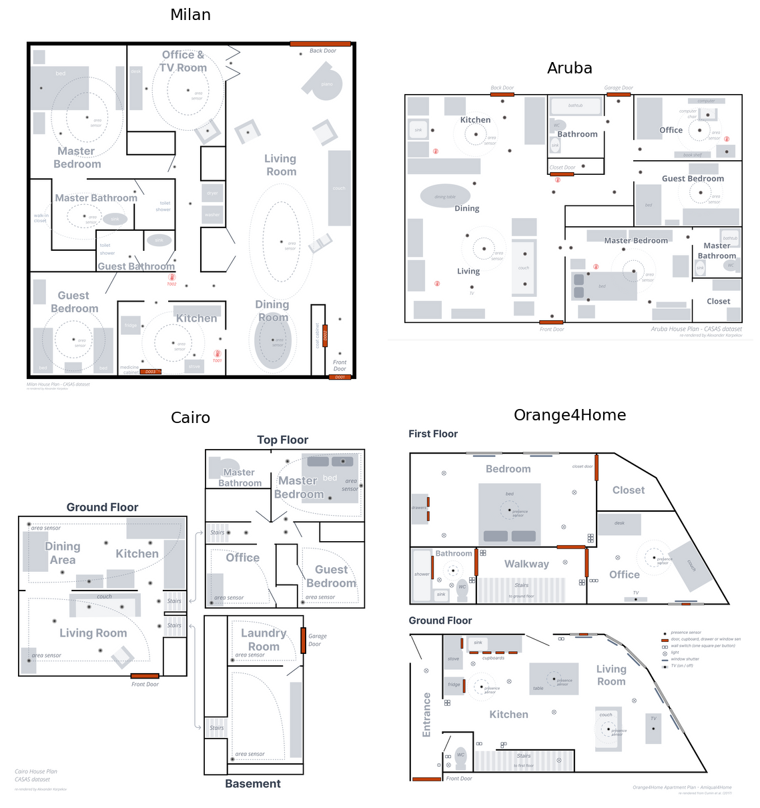

# Smart-home floor plans: CASAS Milan, Aruba, Cairo and Orange4Home

Re-drawn floor plans of four public smart-home datasets from CASAS and Orange4Home, with the position, room and fixture of every sensor. The original dataset layouts are scans or sketches of varying quality; these versions share one visual style, show furniture and fixtures (bed, couch, medicine cabinet, etc.) and mark each sensor's coverage, so they can be used directly in papers, annotation tools and sensor-replay visualizations.



We originally redesigned these plans for the human labeling study of the [DISCOVER paper](https://arxiv.org/abs/2503.01733). We are sharing them with the broader community for future applications, such as human annotation, image-based pre-training and visualization.

## Contents

| Home | Dataset | Floors | Sensors | Folder |
|---|---|---|---|---|
| Milan | CASAS [1] | 1 | 33 (motion, door, temperature) | [`plans/milan`](plans/milan) |
| Aruba | CASAS [1] | 1 | 40 (motion, door, temperature) | [`plans/aruba`](plans/aruba) |
| Cairo | CASAS [1] | 3 (ground, top, basement) | 32 (motion, temperature) | [`plans/cairo`](plans/cairo) |
| Orange4Home | Orange4Home [2] | 2 | 82 (presence, door, light, switch, shutter, TV) | [`plans/orange`](plans/orange) |

Each folder contains:

| File | What |
|---|---|
| `<home>.svg` | Vector source (text converted to outlines; exported from Figma) |
| `<home>.pdf` | Vector PDF, for LaTeX |
| `<home>.png` | 4000 px wide raster |
| `<home>_sensor_ids.png` | The same plan with every sensor ID overlaid |
| `sensors.csv` | One row per sensor (below) |

### `sensors.csv`

| Column | Meaning |
|---|---|
| `sensor_id` | ID as it appears in the dataset's event stream (e.g. `M012`, `kitchen_presence`) |
| `type` | Sensor type from the dataset documentation (e.g. `motion`, `door`, `temperature`) |
| `room` | Room the sensor is in |
| `fixture` | Fixture or spot the sensor watches, where known (e.g. `stove`, `medicine cabinet door`) |
| `x`, `y` | Position in the SVG's coordinate system: user units, origin top-left, `y` pointing down |

Coordinates match the SVG `viewBox`, so they can be drawn on the SVG directly, or on the PNG after multiplying by `png_width / svg_width`.

## Notes and limitations

- **Sensor positions are approximate.** They are placed by hand from the original layouts and are meant for visualization, not for metric distances. A few sensors sit next to, rather than on, their marker on the plan.
- **Orange4Home** documents only the room of each sensor. Positions inside a room are schematic: presence sensors over the named area, contact sensors on their door, cupboard or drawer, shutters on windows, lights on the ceiling. Walls, doors and furniture follow the original Orange4Home floor plans [2].
- **Rooms corrected against the floor plan.** Where the original metadata contradicts the layout, the plan wins: Milan M003 (dining table), M006 (office doorway); Aruba M004, M006, M029, M031, D003; Cairo M011, M014 (stairs), M024 (dining table).
- **Unknown locations.** Cairo's temperature sensors (T001–T005) and Aruba's T005 have no documented location and have empty `room`, `x` and `y`.
- The plans contain no data from the datasets themselves. To use the sensor data, obtain it from its source under its own terms.

## How to cite

If you use these floor plans, please cite this paper and the original datasets:

```bibtex
@article{karpekov2025discover,
  title   = {{DISCOVER}: Identifying Patterns of Daily Living in Human Activities from Smart Home Data},
  author  = {Karpekov, Alexander and Iyer, Archith and Dhekane, Sourish Gunesh and Chernova, Sonia and Pl{\"o}tz, Thomas},
  journal = {arXiv preprint arXiv:2503.01733},
  year    = {2025},
  doi     = {10.48550/arXiv.2503.01733}
}
```

[1] D. Cook, M. Schmitter-Edgecombe, A. Crandall, C. Sanders and B. Thomas, "Collecting and disseminating smart home sensor data in the CASAS project," *CHI 2009 Workshop on Developing Shared Home Behavior Datasets*, 2009. CASAS datasets: <https://casas.wsu.edu/datasets/>

[2] J. Cumin, G. Lefebvre, F. Ramparany and J. L. Crowley, "A dataset of routine daily activities in an instrumented home," *UCAmI*, Springer, 2017.

## License

[CC BY 4.0](LICENSE): free to share and adapt, including commercially, with attribution (cite as above). The underlying layouts are derived from the CASAS and Orange4Home dataset documentation; credit those datasets as well.
